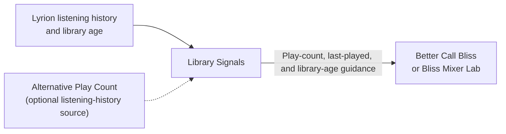

# Bliss Guidance: Library Signals

**Rediscover music from your own library.**

**Bliss Guidance: Library Signals** is an optional plugin for [Lyrion Music Server (LMS)](https://lyrion.org/) that helps compatible Bliss plugins use your listening history and library information to guide music selection.

Your music library may contain songs you have not played in months, new albums that deserve more attention, and tracks you almost never hear. Library Signals helps [Better Call Bliss](https://github.com/chrober/lms-better-call-bliss) and [Bliss Mixer Lab](https://github.com/chrober/lms-blissmixer-lab) prefer musically suitable tracks using those signals. It provides **additional guidance only when enabled in a host**; it is not a standalone mixer.

**Bliss-first by design:** Better Call Bliss and Bliss Mixer Lab first use Bliss acoustic similarity to identify suitable tracks. Library Signals then uses play counts, last-played dates, and library age to influence which of those **already Bliss-eligible tracks** are preferred. It cannot introduce new candidates or override repeat rules; it adds guidance rather than creating its own mixes.

## What can I do with it?

### Rediscover forgotten favorites

*"I want my Don't Stop the Music mixes to bring back songs I haven't heard in a long time."*

Favor tracks whose **last played** date is further in the past.

### Explore recent library additions

*"I've just added several albums and want them to appear more often in my mixes."*

Favor **recently added tracks** so new music gets more listening time. You can also prefer older additions if that better fits your goal.

### Give rarely played songs a chance

*"My mixes keep returning to the same familiar tracks. I'd like to hear more of the rest of my collection."*

Favor tracks with a **lower play count**. You can also choose to favor frequently played songs instead.

These preferences can be useful for **Don't Stop the Music** sessions in Bliss Mixer Lab and playlist or queue optimization in Better Call Bliss, where supported by the host's controls.

**Important:** Library Signals does not choose arbitrary songs. Bliss still defines which tracks are eligible, evaluates acoustic similarity, and enforces repeat constraints. Library Signals contributes preferences within that selection.

## Key features

| Signal | What it tells the host | Possible preference |
| --- | --- | --- |
| **Play count** | How often a track has been played | Less-played or more-played tracks |
| **Last played** | When a track was most recently played | Longer-unheard or recently played tracks |
| **Library age** | When a track was added to the library | Newer or older additions |

- Reads Lyrion's existing listening data without altering it.
- Supports **[Alternative Play Count](https://github.com/AF-1/lms-alternativeplaycount)** as an optional source for play count and last-played information. Library age still comes from Lyrion itself.
- Exposes provider defaults that compatible hosts can override, including per-job controls where supported.
- Treats unknown or missing data neutrally rather than assuming a track has never been played.
- Works as a passive, separately installed guidance provider.

[Alternative Play Count](https://github.com/AF-1/lms-alternativeplaycount)-specific skip history, last-skipped, and DPSV signals are **not** provided by this plugin.

## How it fits into the Bliss ecosystem

| Component | What it contributes | Required? |
| --- | --- | --- |
| [Bliss Mixer](https://github.com/CDrummond/lms-blissmixer) | Acoustic library analysis (`bliss.db`) and base mixing preferences for compatible hosts | Required by host; not by this provider directly |
| [Better Call Bliss](https://github.com/chrober/lms-better-call-bliss) | Playlist and player-queue optimization that can use Library Signals guidance | One of the two compatible hosts |
| [Bliss Mixer Lab](https://github.com/chrober/lms-blissmixer-lab) | Experimental **Bliss (Lab)** Don't Stop the Music mixes that can use Library Signals guidance | One of the two compatible hosts |
| **Library Signals** | Additional play-count, last-played, and library-age guidance for already Bliss-eligible tracks | This plugin |
| [Last.fm Guidance](https://github.com/chrober/lms-guidance-lastfm) | Separate optional similar-track and similar-artist guidance | No |

Install **Better Call Bliss**, **Bliss Mixer Lab**, or both, and enable Library Signals on the **settings page of each host** where you want to use it. Installing Library Signals alone does not change your mixes or player queue. The host is responsible for music selection and output, and the supported guidance controls may differ between hosts.

## Requirements

- **Lyrion Music Server:** Developed and tested with **Lyrion 9.1**. Older versions may also work, but have not been tested.
- **Compatible host:** [Better Call Bliss](https://github.com/chrober/lms-better-call-bliss) or [Bliss Mixer Lab](https://github.com/chrober/lms-blissmixer-lab), installed and enabled. Enable Library Signals separately on the **host plugin's settings page**; installing the provider alone does not affect music selection.
- **Library history:** Access to Lyrion's `persist.db`, which provides play counts, last-played dates, and library-addition dates. Missing values are handled neutrally.
- **Native binary:** A compatible `bliss-guidance-library-signals` executable. Official plugin-feed packages include binaries for Windows, macOS, x86_64 Linux, ARM64 Linux, and ARMHF Linux.
- **Optional:** [Alternative Play Count](https://github.com/AF-1/lms-alternativeplaycount), installed and enabled, as a source for play counts and last-played dates. Library age still comes from Lyrion.

Library Signals itself does **not** require a [Bliss Mixer](https://github.com/CDrummond/lms-blissmixer) installation, a `bliss.db`, or a separate Bliss analysis. Those may be required by the chosen host plugin. [Alternative Play Count](https://github.com/AF-1/lms-alternativeplaycount) is not required: the provider uses Lyrion's native history by default.

## Installation

1. Install and configure a compatible host, such as [Better Call Bliss](https://github.com/chrober/lms-better-call-bliss) or [Bliss Mixer Lab](https://github.com/chrober/lms-blissmixer-lab). Follow that host's own requirements for [Bliss Mixer](https://github.com/CDrummond/lms-blissmixer) and library analysis.
2. Add this repository in **LMS Settings > Plugins**, if it is not already configured:

   ```text
   https://raw.githubusercontent.com/chrober/lms-plugins/main/repo.xml
   ```

3. Install **Bliss Guidance: Library Signals** and restart LMS if requested.
4. Configure the provider's defaults on its own settings page.
5. On the **settings page of [Better Call Bliss](https://github.com/chrober/lms-better-call-bliss) or [Bliss Mixer Lab](https://github.com/chrober/lms-blissmixer-lab)**, **enable Library Signals**. The provider is disabled in each host until you explicitly enable it.

## Getting started

For a simple example, try favoring tracks you have not heard for a long time:

1. Open the **Library Signals** settings and configure the **last-played** preference.
2. On your chosen host plugin's **settings page**, enable the **Library Signals** provider. Check whether the host exposes any overrides for that preference.
3. Create a Bliss mix or preview a playlist optimization using that host.
4. Compare the result with and without Library Signals enabled. Bliss similarity and your existing repeat rules remain in effect in both cases.

You can repeat the experiment with play count or library age—for example, to feature recently added music.

## Configuration and limitations

- Provider settings are defaults; a host or job can override an eligible setting when it supports that control.
- If [Alternative Play Count](https://github.com/AF-1/lms-alternativeplaycount) is installed and enabled, you can choose its play-count and last-played history instead of Lyrion's native values. The plugin continues to use Lyrion's native library age.
- If [Alternative Play Count](https://github.com/AF-1/lms-alternativeplaycount) is requested but unavailable, the provider reports a neutral fallback to Lyrion history. Missing APC records do not become zero play counts.
- The provider offers **preferences**, not guarantees that a particular song will appear. Bliss eligibility and the host's rules still apply.

## Technical details

The separately installed native implementation is [`bliss-guidance-library-signals`](https://github.com/chrober/bliss-guidance-library-signals). It reads Lyrion's `persist.db` in read-only mode, uses the host's frozen eligible-candidate identities, and returns bounded signals through the shared [`bliss-playlist-guidance-spi`](https://github.com/chrober/bliss-playlist-guidance-spi). Provider conventions are described in [`lms-bliss-guidance-provider-kit`](https://github.com/chrober/lms-bliss-guidance-provider-kit).

### Architecture



Library Signals reads listening history and library information from Lyrion's database, optionally using [Alternative Play Count](https://github.com/AF-1/lms-alternativeplaycount) for play counts and last-played dates. It provides additional guidance to Better Call Bliss and Bliss Mixer Lab, helping them prefer tracks based on listening history and library age. The host plugins remain responsible for music selection, mixing, and playlist or queue changes.

## License and credits

See the linked native provider, shared SPI, and [Bliss Mixer](https://github.com/CDrummond/lms-blissmixer) for applicable licenses and attributions.
